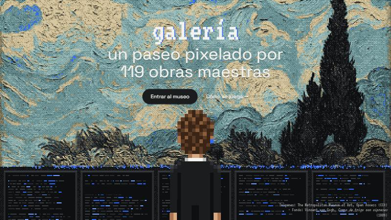
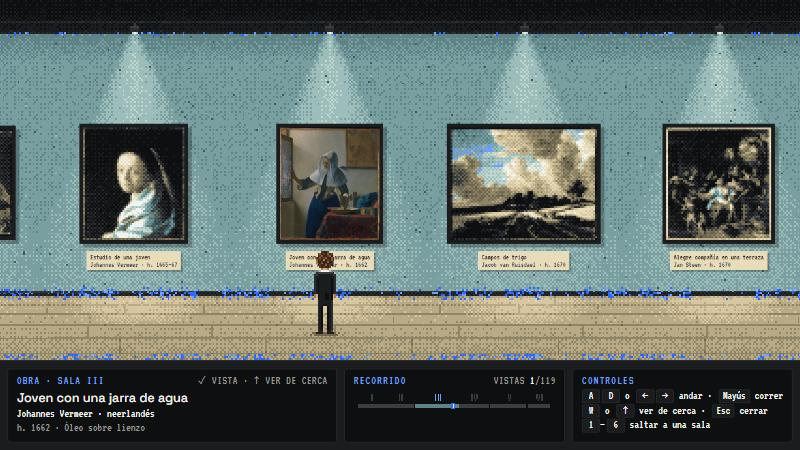

# Galería — un museo pixelado

Un museo de arte convertido en **videojuego 2D de scroll lateral**. Un personaje recorre seis salas
ordenadas por épocas y va viendo **119 obras maestras** de la pintura europea, de Duccio (h. 1300) a
Klimt (1913), todas de dominio público y procedentes del Metropolitan Museum of Art de Nueva York.

HTML + CSS + JavaScript, sin frameworks, sin dependencias y sin paso de compilación.

**[▶ Jugar en el navegador](https://danielmcpri2309-code.github.io/galeria-pixelada/)**



## La idea

El concepto visual es el **contraste**. Todo el museo (paredes, suelo, focos, personaje e interfaz)
está dibujado en pixel art, con una paleta reducida y **dithering**, como una foto antigua tratada
para una pantalla de pocos colores. Los cuadros, en cambio, se ven **en alta calidad y con su color
original**.

Pero solo cuando te acercas. De lejos, cada cuadro también aparece pixelado con la paleta del museo.
Al acercarte, la imagen real **se revela píxel a píxel**, y si te paras delante, el personaje se
gira y se queda de espaldas mirándolo.



## Qué se puede hacer

- **Recorrer seis salas** con su rótulo en la pared, focos con conos de luz, bancos y puertas entre salas:

  | Sala | Época | Obras |
  |---|---|---|
  | I | Gótico y primer Renacimiento (1300–1500) | 17 |
  | II | Alto Renacimiento y Manierismo (1500–1600) | 18 |
  | III | Barroco (1600–1700) | 28 |
  | IV | Rococó y Neoclasicismo (1700–1830) | 19 |
  | V | Realismo e Impresionismo (1830–1885) | 23 |
  | VI | Postimpresionismo (1885–1915) | 14 |

- **Mirar un cuadro**: al pararte delante, el panel inferior muestra su cartela (título, artista,
  nacionalidad, fecha y técnica) y la obra cuenta como vista.
- **Verlo de cerca** en un visor a pantalla completa con la ficha y un enlace a la página de la obra
  en el Met. Primero carga la versión ligera y, cuando llega, la cambia por la de máxima resolución.
- **Seguir tu progreso** en el mapa del recorrido: las seis salas, un punto azul donde estás y una
  marca por cada obra vista. El contador se guarda en el navegador.
- **Saltar de sala** con las teclas `1`–`6` o haciendo clic en el mapa.
- **Jugar en el móvil** con botones táctiles. En vertical, la pantalla se organiza como una consola
  portátil: el museo arriba y los mandos abajo.

## Controles

| Tecla | Acción |
|---|---|
| `A` `D` o `←` `→` | andar |
| `Mayús` | correr |
| `W`, `↑` o `Enter` | ver de cerca el cuadro que tienes delante |
| `↓` o `Esc` | cerrar el visor |
| `1`–`6` | saltar a una sala |

También puedes hacer clic en un cuadro para abrirlo, o en una sala del mapa para ir a ella.

## Cómo abrirlo

- **En línea**: con el enlace de arriba.
- **En tu ordenador**: descarga o clona el repositorio y haz doble clic en `index.html`.
  No hace falta servidor ni instalar nada. (Las fuentes y las imágenes de las obras se cargan
  desde internet.)

## Cómo está hecho

### Todo en píxeles lógicos

El museo se dibuja en canvas pequeños, en "píxeles lógicos", y el navegador los amplía sin suavizar
(`image-rendering: pixelated`). La escala es siempre un número **entero de píxeles físicos**
(teniendo en cuenta `devicePixelRatio`), para que todos los píxeles midan lo mismo en cualquier
pantalla. Los elementos HTML (cuadros, cartelas, rótulos) se colocan con variables CSS en esas mismas
unidades: `left: calc(var(--x) * var(--px))`.

### Dithering ordenado (matriz de Bayer 4×4)

Para cada píxel del entorno se calcula un **brillo** sumando capas: el tono del material, la sombra
del techo, el cono de luz del foco y un poco de grano. Ese brillo se convierte en uno de los colores
de la paleta comparándolo con la matriz de Bayer, que reparte los colores en una trama regular. El
grano usa un **ruido determinista** (una función hash), así que el museo sale idéntico cada vez que
se genera.

Los cuadros se pixelan con la misma idea en color: reducción al tamaño del cuadro, **niveles
automáticos** (histograma), un poco más de saturación y, para cada píxel, el **color más cercano**
de la paleta tras sumarle el desplazamiento de Bayer.

### El revelado: una disolución de Bayer

Encima del cuadro pixelado está la imagen real con una **máscara CSS** (`mask-image`) de 4×4 celdas.
Según la distancia al personaje, la máscara deja ver más o menos celdas en el orden de la matriz de
Bayer, en 16 escalones. Cada celda mide justo un píxel lógico, así que la imagen aparece alineada con
la rejilla del museo. La misma técnica, animada en el tiempo, sirve para el visor, la salida de la
portada y la cortinilla al saltar de sala.

### El personaje

Los sprites son **matrices de caracteres**: cada letra es un color (`H` pelo, `T` traje, `S` piel…)
y el punto es transparente. Al cargar la página se convierten en canvas de 16×44.

- El sprite de lado se monta con piezas: cabeza, torso con el brazo y cuatro posturas de piernas.
- El rebote al andar y la respiración en reposo salen de una sola función que baja un píxel la
  mitad superior del sprite.
- La animación avanza según la **distancia recorrida**, no según el tiempo, para que los pies no
  patinen.
- Una pequeña máquina de estados (andando → quieto → mirando) decide cuándo se gira de espaldas.

### La escena por capas

1. **Entorno**: un canvas por sala, generado píxel a píxel.
2. **Cuadros, cartelas y rótulos**: elementos HTML.
3. **Personaje**: un canvas transparente por delante.

Las dos primeras están dentro de un contenedor que la cámara desplaza entero con un `transform`, así
que mover la cámara cuesta lo mismo que mover un solo elemento.

### Rendimiento

- **Un único bucle** con `requestAnimationFrame` y movimiento basado en el tiempo (`dt`).
- **Cámara subpíxel**: la cámara y el personaje se colocan con precisión de píxel *físico*. El pixel
  art sigue nítido y el movimiento es regular, sin los saltos irregulares de mover el mundo de píxel
  lógico en píxel lógico. La cámara sigue al personaje con un suavizado exponencial.
- **Trabajo en segundo plano**: el entorno de cada sala tarda unos 20 ms en generarse, así que se
  hace con `requestIdleCallback` mientras se ve la portada, en vez de al llegar a la sala.
- **Carga perezosa**: solo se descargan las imágenes de los cuadros cercanos a la cámara.

Medido en un recorrido de tres salas: el fotograma más lento bajó de 33 ms a 1,3 ms.

### Otros detalles

- **Visor** con el elemento nativo `<dialog>` (`showModal()` gestiona el foco y la tecla Esc).
- **Teclado** con `evento.code` (la tecla física) y un `Set` de teclas pulsadas, para que ninguna
  se quede "pegada" al combinarla con Mayús.
- **Pantallas táctiles** con *pointer events*, que funcionan igual con dedo, ratón o lápiz.
- **`localStorage`** siempre dentro de `try/catch`: en modo privado puede fallar y el juego debe
  seguir funcionando.
- **Accesibilidad**: respeta `prefers-reduced-motion`, la cartela se anuncia con `aria-live` y
  todas las imágenes tienen texto alternativo.

### Las imágenes del Met y CORS

Para pixelar un cuadro hay que leer sus píxeles (`getImageData`), y eso solo se puede hacer si la
imagen llega con permiso CORS. El CDN del Met guarda en caché la versión normal de cada imagen sin
esa cabecera, así que el juego las pide con un parámetro (`?galeria-cors`), que sí la trae. Una URL
con ese parámetro se pide **siempre** con CORS: si se pidiera sin CORS, el CDN guardaría una copia
sin la cabecera y fallaría para todos. Si aun así falla, el cuadro se muestra sin pixelar (plan B).

## Estructura

```
index.html          estructura de la página: escena, HUD, portada, visor y ayuda
css/estilos.css     estilos, paleta, tipografías y diseño para móvil
datos/obras.js      las 119 obras y las 6 salas
js/dither.js        paleta, dithering de Bayer, ruido, pixelado de imágenes y máscaras
js/sprites.js       el personaje: matrices de caracteres → canvas, animaciones
js/museo.js         plano del museo, entorno pixelado, cuadros, rótulos, revelado y carga perezosa
js/interfaz.js      HUD (cartela, mapa, obras vistas), visor y animaciones con máscaras
js/portada.js       portada y ayuda "Cómo se juega"
js/juego.js         bucle principal, controles (teclado y táctiles), cámara y saltos entre salas
docs/               capturas para este README
```

Los scripts son "clásicos" (no módulos ES) y los datos están en un `.js`, no en un `.json`: así
el juego funciona abriendo `index.html` con doble clic, sin servidor.

## La colección

Son **todas** las obras destacadas (`isHighlight`) del departamento de Pintura Europea del Met que
son de dominio público: 119 de 125. Las otras 6 (entre ellas dos Monet y un Morisot) no son de
dominio público. Los datos se obtuvieron de la
[API de la colección del Met](https://metmuseum.github.io/), pidiendo las obras de una en una con
pausas (la API bloquea a quien hace muchas peticiones seguidas), y los títulos, técnicas y fechas
están traducidos al español. El juego no llama a la API: todo está en `datos/obras.js`.

## Cómo se desarrolló

Por fases, comprobando el resultado al final de cada una:

1. Esqueleto: el personaje (un rectángulo) se mueve y la cámara lo sigue.
2. Museo con dithering, cuadros colgados con sus cartelas y rótulos de sala.
3. Personaje en pixel art: anda, respira y se gira de espaldas ante los cuadros.
4. Revelado de los cuadros al acercarse.
5. HUD (cartela, mapa, obras vistas) y visor.
6. Portada, saltos entre salas, controles táctiles y adaptación a móvil.
7. Ampliación de la colección con la API del Met (de 76 a 119 obras).

Después: controles WASD y optimización del movimiento.

## Créditos

- **Imágenes**: [The Metropolitan Museum of Art](https://www.metmuseum.org/), Open Access (CC0).
- **Fuentes**: [VT323](https://fonts.google.com/specimen/VT323) y
  [Space Grotesk](https://fonts.google.com/specimen/Space+Grotesk), de Google Fonts.
- **Fondo de la portada**: Vincent van Gogh, *Campo de trigo con cipreses* (1889).

## Licencia

El código de este proyecto se distribuye con la [licencia MIT](LICENSE): puedes usarlo, copiarlo y
modificarlo libremente, siempre que mantengas el aviso de copyright.

La licencia cubre el código, no las obras ni las fuentes. Las imágenes de los cuadros son de dominio
público (Open Access CC0 del Met) y se cargan desde los servidores del museo; las fuentes VT323 y
Space Grotesk tienen su propia licencia (SIL Open Font License) y se cargan desde Google Fonts.
